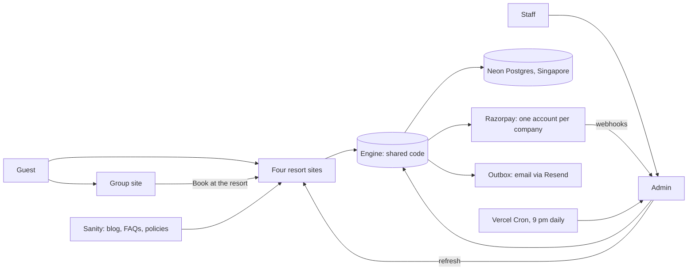
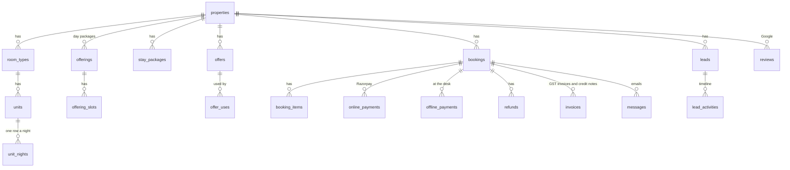

# Prathamesh Group platform: handover

This guide is for the people who run and change the platform (QA-03). It covers the setup on a new computer, every setting, how the parts fit together, deploys, database changes, backups and restore, and short guides for staff. The plan and the history of decisions are in `docs/implementation-plan.md`.

## 1. What there is

| Part | Folder | Address today | What it does |
|---|---|---|---|
| Khed Shivapur site | `apps/khed-shivapur` | prathameshresorts.vercel.app | The resort's website, booking and payment |
| Go Crazy site | `apps/go-crazy` | gocrazyadventure.vercel.app | The same, for Go Crazy |
| Sinhagad Bliss site | `apps/sinhagad-bliss` | sinhagadbliss.vercel.app | The same, for Sinhagad Bliss |
| Valley site | `apps/valley` | prathameshvalleyresorts.vercel.app | The same, for Valley Resorts |
| Group site | `apps/group` | Not deployed yet: waits for the group domain | Search across the four resorts, weddings, corporate, blog |
| Admin | `apps/admin` | prathamesh-admin.vercel.app | Staff: bookings, rooms, prices, packages, offers, leads, reports, settings |
| Sanity Studio | `apps/studio` | prathamesh-resorts.sanity.studio | Blog posts, FAQs and policy pages |

Shared code lives in `packages`:

- `db`: the database tables (Drizzle) and migrations.
- `engine`: the booking rules: availability, holds, prices, GST, offers, packages, payments, refunds, messages, reports' jobs.
- `auth`: staff sign-in (Better Auth, Google) and permissions.
- `booking-ui`: the booking widget and the shared site parts: calendar, tray, checkout, cookie banner, WhatsApp button, forms.
- `website`: what a site reads from the admin, and the site's server actions.
- `sites`: the four resorts' names, places and addresses.
- `sanity`: reading blog posts, FAQs and policies from Sanity.

Every app uses the same database, so all four sites, the group site and the admin always agree on what is free.

## 2. Set up on a new computer

1. Install Node 22 or later and PostgreSQL 17 or later. pnpm is not installed globally; use `npx pnpm@12.16.1` (the version in `package.json`).
2. `npx pnpm@12.16.1 install`
3. Copy `.env.example` to `.env.local` at the repo root and fill it in (section 3). For local work, use a local database:
   `createdb prathamesh_dev`, then set `DATABASE_URL` and `DATABASE_URL_UNPOOLED` to `postgresql://localhost:5432/prathamesh_dev`.
4. Create the tables and the starting data:
   `DATABASE_URL=postgresql://localhost:5432/prathamesh_dev DATABASE_URL_UNPOOLED=postgresql://localhost:5432/prathamesh_dev npx pnpm@12.16.1 --filter @repo/db db:migrate`, then `db:seed` and `db:import-sites` the same way.
5. Start what you need, each in its own terminal, with the local database in front of the command:
   - admin: `npx pnpm@12.16.1 --filter admin dev` (port 3010)
   - sites: `--filter khed-shivapur dev` (3000), `go-crazy` (3001), `sinhagad-bliss` (3002), `valley` (3003), `group` (3004)
6. Sign in to the local admin: with the local database, the sign-in page sends a magic link to the dev log for seeded staff such as `owner@prathamesh.test`.

**Careful:** the root `.env.local` may point at the production database on Neon. Always put the local `DATABASE_URL` and `DATABASE_URL_UNPOOLED` in front of local commands, and check the host before you run a migration.

Checks before a commit: `npx turbo run typecheck lint` and, for the engine, `cd packages/engine && npx vitest run` (needs the local PostgreSQL; it makes its own test databases).

## 3. Settings (environment variables)

All settings live in one file, `.env.local` at the repo root, locally, and in each Vercel project's settings online. `.env.example` lists them with notes. Turborepo passes only the variables each app's `turbo.json` lists.

| Setting | Where | What it is |
|---|---|---|
| `DATABASE_URL`, `DATABASE_URL_UNPOOLED` | all apps | Neon's pooled address, and the direct one for migrations |
| `BETTER_AUTH_SECRET`, `BETTER_AUTH_URL` | admin | Staff sign-in: a long random secret, and the admin's address |
| `GOOGLE_CLIENT_ID`, `GOOGLE_CLIENT_SECRET` | admin | The Google sign-in app |
| `GOOGLE_WORKSPACE_DOMAIN` | admin | Optional: only this Google Workspace domain may sign in (USR-07) |
| `SEED_SUPER_ADMIN_EMAIL`, `SEED_SUPER_ADMIN_NAME` | seed | The first Super Admin |
| `WEBSITE_URLS` | admin | Each site's address, such as `KS=https://…,GC=https://…,GROUP=https://…` |
| `REVALIDATE_SECRET` | admin and sites | Shared secret for "refresh the website" calls |
| `SANITY_WEBHOOK_SECRET` | admin | Signs Sanity's publish calls |
| `RAZORPAY_KEY_ID`, `RAZORPAY_KEY_SECRET` | admin and sites | The shared test account, used until a resort's own keys are saved in Settings |
| `RAZORPAY_WEBHOOK_SECRET` | admin | The test account's webhook secret |
| `PAYMENT_KEYS_SECRET` | admin and sites | Encrypts each resort's Razorpay keys in the database (AES-256-GCM). Never change it once keys are saved |
| `RESEND_API_KEY`, `EMAIL_FROM_ADDRESS` | admin and sites | Email sending. Without them, email waits in the outbox |
| `RESEND_WEBHOOK_SECRET` | admin | Signs Resend's delivery reports |
| `CRON_SECRET` | admin | Vercel Cron's call to `/api/cron` |
| `ADMIN_URL` | admin and sites | The admin's address, for links in alerts and the sites' build-time redirects |
| `GOOGLE_PLACES_API_KEY` | admin | Reads Google reviews |
| `DEPLOY_HOOKS` | admin | Vercel deploy hooks per resort, so a new redirect rebuilds that site |
| `META_VERIFY_TOKEN`, `META_APP_SECRET`, `META_PAGE_TOKEN`, `META_LEAD_FORMS` | admin | Meta lead ads into the CRM |
| `NEXT_PUBLIC_GTM_ID`, `NEXT_PUBLIC_META_PIXEL_ID` | each site | Google Tag Manager and the Meta Pixel, loaded only with consent |
| `META_PIXEL_ID`, `META_CAPI_TOKEN` | each site | Meta's server-side Conversions API |
| `GROUP_SITE_URL` | group | The group site's address |
| `BLOB_READ_WRITE_TOKEN` | admin | The public Vercel Blob store, for gallery photos |
| `BLOB_PRIVATE_READ_WRITE_TOKEN` | admin | The private Vercel Blob store, for guests' ID proofs |
| `TEST_DATABASE_ADMIN_URL` | tests | The local PostgreSQL the engine tests use |

## 4. How it fits together

- **Prices are only ever worked out on the server.** The browser sends what the guest chose by code; the engine holds the rooms or seats, prices them, takes off the best offer, adds GST, and the Razorpay order uses that amount (PR-08).
- **No double bookings.** Each room has at most one row per night (`unit_nights`, unique on room and night), so two guests can't hold the same room (INV-03). Day packages count seats per slot per day.
- **Sites cache what the admin sets.** Rooms, rates, packages, offers, notices and reviews are cached until the admin calls the site's `/api/revalidate`. Availability and prices for a search are always read live.
- **Messages go through an outbox** (`messages`). A message is written with the change it reports and sent after the request, or by the daily job.
- **Background jobs** run on Vercel Cron, each at `/api/cron/<job>` with `CRON_SECRET`. Each takes a lock in `job_runs`, so a doubled call runs once, and records its last result or error.

  | Job | When (India time) | What it does |
  |---|---|---|
  | `frequent` | every 15 minutes 6:30 am to 11:15 pm, hourly at night | ends holds that ran out (unpaid website bookings become leads), rechecks payments and refunds, follow-up reminders, sends email |
  | `reviews` | every 2 hours in the day | Google reviews |
  | `morning` | 6 am | yesterday's Razorpay settlements, ID proofs past their retention, old rate-limit counts |
  | `guests` | 10 am | before-arrival and thank-you emails, the low-rooms alert |
  | `summary` | 9 pm | the day's sales summary |
  | `periodic` | 8 am | the week's summary on Mondays, the month's on the 1st |

- **Hobby or Pro.** Vercel's Hobby plan allows each cron job once a day, so `apps/admin/vercel.json` runs every job once a day at the times above (`frequent` at 6:30 am). After moving the team to Pro, copy `apps/admin/vercel.pro.json` over `apps/admin/vercel.json` and deploy: that turns on the 15-minute and 2-hour runs. Until then, the sites also recheck a payment while the guest waits on their booking page.
- **Files** go to Vercel Blob straight from the browser, with a short-lived token from `/api/blob/upload`: gallery photos to the public store, ID proofs to the private store. ID proofs open only through the admin, which checks the role and logs each view.

### Main tables

The full schema is in `packages/db/src/schema`. Money is whole paise; nights are dates; times are UTC shown in India time.

## 5. Deploys

- Each app is its own Vercel project, linked to the GitHub repo, built from `main`. A push to `main` deploys every app that changed (`npx turbo-ignore` skips the rest).
- Pull requests get preview deploys.
- **Database changes go first.** Vercel builds never run migrations. Before merging a change with a new file in `packages/db/migrations`, apply it to Neon production:
  `DATABASE_URL=<direct Neon address> DATABASE_URL_UNPOOLED=<same> npx pnpm@12.16.1 --filter @repo/db db:migrate`
  Every migration only adds tables, columns or rows, so the running apps keep working before the deploy.
- To make a new migration: change `packages/db/src/schema`, then run `npx drizzle-kit generate --name <what>` in `packages/db`. Read the SQL before you commit it.
- Rolling back: Vercel's Instant Rollback returns an app to an earlier deploy. Migrations add only, so older code still works with the newer tables.

## 6. Backups and restore

- **Nightly copies** (REL-02): `.github/workflows/backup.yml` runs at 2 am in India. It copies the production database with `pg_dump` (Postgres 18) and, if `SANITY_AUTH_TOKEN` is set, exports the Sanity dataset. Each copy stays 30 days as a workflow artifact. Set the GitHub secret `NEON_DATABASE_URL_UNPOOLED` once.
- **Neon** also keeps 6 hours of history on the Free plan, for a quick undo.
- **To restore** a copy into a new, empty database:
  1. Download the artifact from the workflow run in GitHub, and unzip it.
  2. Create a new Neon branch or database, and take its direct address.
  3. `docker run --rm -i postgres:18 pg_restore --no-owner --no-privileges -d "<new direct address>" < prathamesh-db-YYYY-MM-DD.dump`
  4. Check a few bookings and the latest invoice number, then point `DATABASE_URL` at it if you mean to switch.
- **Test the restore once before go-live** (URD acceptance test 24) and note the date here.
- Sanity: `npx sanity dataset import prathamesh-sanity-YYYY-MM-DD.tar.gz production --replace` from `apps/studio` restores the content.

## 7. Outside accounts and what each needs

| Account | Needed for | Status |
|---|---|---|
| Razorpay, one per company | Live payments | Test account works. Each company's live keys go in admin → Settings → Online payments, with its webhook at `https://<admin>/api/webhooks/razorpay/<CODE>` |
| Resend | Email | Needs an account and the four sending domains (SPF, DKIM, DMARC), then `RESEND_API_KEY`, `EMAIL_FROM_ADDRESS` and the webhook at `/api/webhooks/resend` |
| Google Cloud | Staff sign-in; reviews | Sign-in is set up. Reviews need a Places API key and each resort's place id (admin → Website) |
| Meta | Pixel, Conversions API, lead ads | Pixel and token per site; lead ads need a Meta app and `META_LEAD_FORMS` |
| Google Tag Manager | GA4 and Google Ads | A container id per site in `NEXT_PUBLIC_GTM_ID`; set up GA4 and Ads tags inside GTM to read the events below |
| WhatsApp and SMS | Messages by WhatsApp and SMS | Provider not chosen. The outbox has a channel for each; templates need approval |
| Vercel | Hosting and files | Pro plan for the 15-minute jobs. Create two Blob stores and connect them to `prathamesh-admin`: a public one (`BLOB_READ_WRITE_TOKEN`) and a private one, its token renamed `BLOB_PRIVATE_READ_WRITE_TOKEN` |
| Neon | Database | Free plan; watch the monthly compute hours |

**Events for Tag Manager** (TRK-01): `begin_checkout`, `add_payment_info`, `purchase` (with `value`, `transaction_id` and `booking_id`) and `generate_lead` (with `lead_type`). The Meta Pixel gets `Purchase` and `Lead` with the same event id the server sends.

## 8. Staff guide (admin)

Sign in with the Google account the Super Admin invited. The resort switcher at the top left changes resort; you see only your resorts and the pages your role allows.

- **Today:** arrivals, departures, guests in house, sales, rooms booked, money waiting, new leads and follow-ups due, and rooms running low.
- **Bookings:** find by number, name, phone or email. A booking's page has ID proofs (Front Desk, Property Manager and Super Admin: from the phone camera or a file, deleted on their own after the days in Settings), check-in and check-out, room changes, changing dates or guests, payments taken at the desk, payment links, refunds, invoices, Send the booking page, Resend the confirmation, notes, printing, and its emails with what happened to each.
- **New booking:** for phone, walk-in, WhatsApp, agents and companies. Choose an offer or set a price by hand with a reason.
- **Leads:** the list or the Board. Drag a card to move it on. On a lead: call, WhatsApp, log a conversation, set the follow-up date and time, write a quotation (it prints to PDF), record an advance, merge a duplicate, make the booking. "Who gets new leads" sets who takes website leads in turn. Excel exports the list (Super Admin and Sales).
- **Guests:** each guest's bookings and spend, tags and notes, data export and removal on request (Super Admin), and the Excel of guests who agreed to offers.
- **Calendar:** rooms against dates. Block a room, a room type or the whole resort; set stay rules and date prices.
- **Rooms, Prices:** room types and rooms; rates for weekdays, weekends and seasons, extra guests and children.
- **Packages:** day packages with time slots and seats a day; stay and staycation packages; add-ons. Duplicate to make a similar one.
- **Offers:** offers and coupons with their rules, and the Offer of the Day schedule.
- **Website:** the website's connection and Refresh now, notices, page text (save a draft, then publish), the gallery (add many photos at once into a category, then edit alt text and captions, order, feature, hide or remove), Google reviews (feature or hide), redirects.
- **Reports:** the overview and the report tabs; All resorts for group totals; Excel, CSV and Print.
- **Settings (Super Admin):** company details and GSTIN (shown in each site's footer), times, hold time, advance, refund limit, who gets the team alerts and the sales summaries, the review and directions links, online payments, GST rules, cancellation rules, and the wording of each email.
- **Staff and Audit log (Super Admin):** invite people with a role and resorts; switch them off; see every change.

## 9. Content guide (Sanity Studio)

Open https://prathamesh-resorts.sanity.studio and sign in. Each resort has a folder with its blog posts, FAQs (drag to reorder) and policies page; authors and categories are shared. A post shows from its "Show from" time. Publishing refreshes the site within a minute. Photos need alt text; keep search titles under 60 characters and descriptions under 160.

Rooms, prices, packages, offers and anything with a date or a number are not in Sanity: they are in the admin.

## 10. What is not built yet

These wait on decisions or accounts outside the code:

- WhatsApp and SMS messages (provider and approved templates).
- Live Razorpay keys, Resend sending domains, the Google Places key, Meta and Tag Manager ids.
- The group site's domain and Vercel project.
- Separate Sanity logins per resort (needs Sanity's paid plan).
- Error tracking (Sentry) and uptime monitoring.
