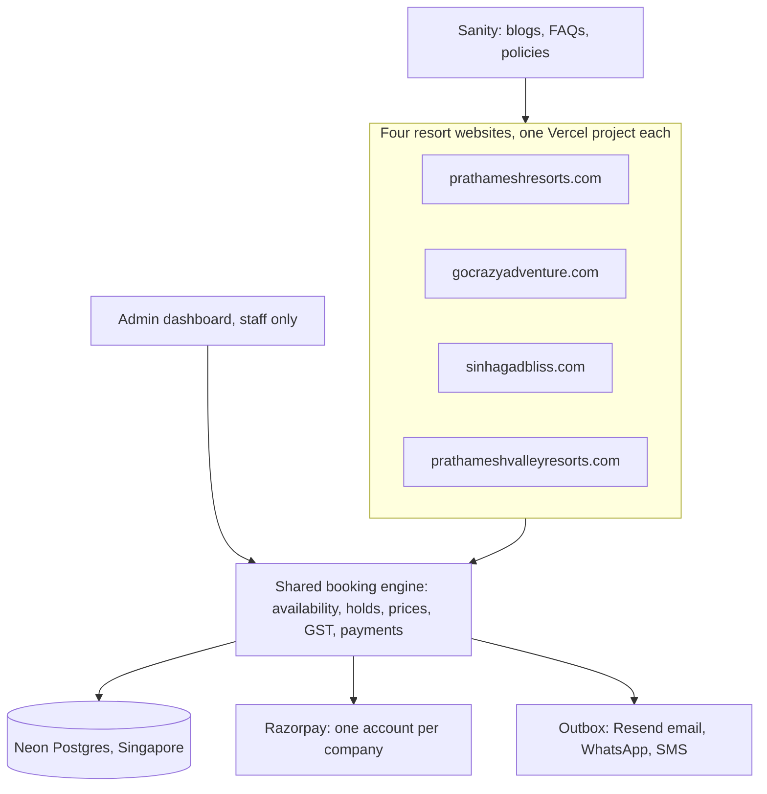

# Prathamesh Group booking platform: implementation plan

- **Status:** proposed, 3 November 2026
- **Scope:** four resort websites and one admin dashboard. A fifth "group" website comes after the four.
- **Features from:** the User Requirement Document (URD) by Priyam IT Services, 1 November 2026. This plan uses its features, not its technical choices.
- **Team assumed:** two full-stack developers and one designer.

## Decisions so far

| Topic | Decision |
|---|---|
| Stack | Turborepo, Next.js 16, Neon Postgres, Drizzle, Better Auth, Resend, Vercel, Razorpay |
| Database plan | Neon Free. Section 4 explains its limits and when to upgrade |
| Database region | Singapore. Neon has no India region |
| Content | Sanity Free, for the blogs, FAQs and policies text. The admin dashboard manages everything else |
| Group website | Built after the four resort sites |
| Old data | None. This is a new application with no bookings to import |

## Progress

| Date | What happened |
|---|---|
| 3 November 2026 | The site moved into this Turborepo monorepo (pull request 1, merged) |
| 3 November 2026 | Go Crazy, Sinhagad Bliss and Valley got their own sites in `apps/go-crazy`, `apps/sinhagad-bliss` and `apps/valley`, each with its own design and the resort's own photos |
| 3 November 2026 | `packages/booking-ui` holds the front of the booking widget: search, the room and day-pass lists, several rooms of any type in one booking, and the tray. Until the engine and payments exist, it sends the request on WhatsApp. `packages/sites` holds the four resorts' names, places and domains |
| 3 November 2026 | Each site redirects the old WordPress pages to the new ones. prathameshresorts.com links to the other three resorts from its menu and home page |
| 4 November 2026 | The backend's foundation: `packages/db` (every table from section 4 for resorts, staff, the catalogue, stock and bookings, plus offerings sold by the seat, such as day packages, activities and restaurant sittings), `packages/auth` (Better Auth for staff, invitation only, with `can()`), `packages/engine` (availability, holds, prices, bookings, blocks and the expiry job, with 21 tests including the race for the last room) and `apps/admin` (sign-in, rooms and units, staff) |
| 4 November 2026 | The database runs on Neon: project `withered-fire-71704216`, branch `production`, Singapore. Migrations and the seed are applied. Neon Auth is provisioned on the branch but unused: the admin keeps its own Better Auth (section 7). Neon object storage is not set up yet: it needs `neon login` with the account that owns the project |
| 4 November 2026 | The admin's bookings and front desk: each resort's day (ADM-01) with charts for sales and rooms booked (ADM-02), the booking list with filters and search (ADM-03), the booking page with its timeline (ADM-04), check-in, check-out, no-show, cancel, room changes, notes and printing (ADM-05), and offline bookings through the engine (ADM-06) with a price set by hand and a reason (ADM-07). Payments taken at the resort go in `offline_payments`. The engine now books a part-paid booking's rooms, not just a confirmed one's |
| 4 November 2026 | The admin's inventory calendar (INV-06): rooms against dates, coloured for free, booked, checked in, held and blocked, with each type's free rooms and price. Staff block a room, a type or the whole resort (INV-04, INV-05), set stay rules (INV-08) and prices for dates (PR-04) from it, and the inventory log shows every change (INV-07). A guest who leaves early, or never comes, frees the nights still ahead |
| 4 November 2026 | The admin's Prices tab: each room type's rates for weekday, weekend or every night, per room or per adult, with extra adult, extra bed, meals and a price for each child age band (PR-01, PR-02, PR-05); the weekend nights; seasons with their own rates and a priority (PR-03); and the age bands. A price left empty stays unpublished, so guests see "rate to confirm" |
| 4 November 2026 | The admin's Packages tab (INV-09, PKG-01, PKG-02): day packages, activities and meal sittings with prices by age band, the days and dates they are sold, time slots with their usual seats a day, seats set for chosen days, the seats left for the week, duplicating and taking off sale. A day's seats can't be set below the guests already booked. Stay and staycation packages linked to room types are still to come |
| 4 November 2026 | The admin's Settings tab (company details, GSTIN, check-in and check-out times, hold time, low-rooms limit; Super Admin only), the audit log for Super Admin and Accounts (who, when, IP, and each field before and after; USR-05), and editing and reordering room types (RM-01). Checked in the browser for Super Admin, Front Desk and Accounts: each sees only its tabs and actions |
| 4 November 2026 | The admin is deployed as the Vercel project `prathamesh-admin` at https://prathamesh-admin.vercel.app, with functions in Singapore next to Neon. Google sign-in works there and on http://localhost:3010. The first Super Admin is on Neon. Pull request 4 merged that day. The work after it comes to main in pull request 5. Until that merges, the admin's production build comes from the `backend-foundation` branch |
| 4 November 2026 | The admin moved to shadcn/ui (Radix, new-york style) in the group's green: a collapsible sidebar with a resort switcher and the resort's sections, a breadcrumb and search bar, number cards and charts on the Today page, tables, badges, dialogs and side panels for every form, date pickers instead of the browser's, and toasts for successes. Checked end to end in the browser, and for Front Desk and Accounts |
| 5 November 2026 | The live admin had lost its colours: Vercel restored Turbopack's build cache and shipped the stylesheet of an older `globals.css`. The admin now builds without that cache. Every page was redesigned on top: Geist type, each resort's own photo, a page of all resorts with today's numbers for each, a Today page with a Front desk card and a Money card, a one-line filter bar for bookings, a summary strip on each booking, numbered steps for a new booking, stays drawn as bars on the calendar, compact Rooms, Prices and Packages pages, a role guide on Staff, the audit log grouped by day, a sign-in page with the four resorts, and loading, not-found and error screens. Checked end to end in the browser, at phone width, and for Front Desk and Accounts |
| 6 November 2026 | The admin runs the websites' rooms, rates and day packages. `db:import-sites` brought each site's rooms, rates and day packages into the database (Go Crazy, Sinhagad Bliss and Valley joined Khed Shivapur), and room types gained their website text: tagline, description, features and the Stays-page section. The sites' Stays and Day packages pages read from the admin through `packages/website`, cached until the admin calls the site's `/api/revalidate` after a change, and show their own content when the database is out of reach. A most-guests limit may be left unpublished instead of guessed |
| 6 November 2026 | Leads (section 9): every booking request from a website's widget and every enquiry form message is kept as a lead, besides the WhatsApp message. The admin's Leads page lists them by status with follow-ups due; each lead has its request, a timeline, an owner, a follow-up day, notes, and "Make a booking", which fills in the guest and marks the lead booked. The Today page lists new leads and follow-ups due |
| 6 November 2026 | Offers and coupons (section 9: Offers). An offer takes a percentage or an amount off, or is applied by the team, for stays, day visits or both, with first and last dates and a fewest-nights rule. A coupon is an offer with a code, in the same `offers` table. Offers on the website show under the booking planners, without their codes. Staff choose one when they make a booking; the admin checks it and takes the discount off the price, with the offer's name as the reason |
| 6 November 2026 | Reports (section 9: Reports), for a resort and a period: sales by the day each booking was made, money received by method, rooms booked against rooms for sale for each room type, day-visit guests by package, and leads by status, interest and source, with a CSV of the bookings. Settlement, refund, GST and scheduled reports come with payments |
| 6 November 2026 | Guests (ADM-09, ADM-10). A guest is every booking with the same phone, or the same email when there is no phone. Each guest has their bookings at the resorts a person works at, what they spent, the nights they stayed, their leads, tags, a note, and whether they agreed to hear about offers (`guest_profiles`). On a guest's request, under India's data protection law (the DPDP Act), a Super Admin downloads their data or removes their personal details. The bookings stay, without them |
| 6 November 2026 | Changing a stay (BK-06). Staff change a booking's dates, rooms and guests. The engine frees the old nights and takes the new ones in one transaction, so a change can never double-book. The new price shows before saving, with the amount to collect or to refund. A checked-in stay keeps its check-in. Each change goes on the timeline with its reason |
| 6 November 2026 | The admin's Website page (section 9: Website), for each resort. It shows the website's connection with a Refresh now button (moved from Settings), the website's notices, and what its Stays and Day packages pages and its offers show from the admin. A notice, such as "The pool is closed for cleaning on 12 November", shows in a small card at the foot of every page, from its first day to its last, one at a time. Guests can close it, and their browser remembers. Notices (`site_notices`) take the place of the pop-ups and the announcement bar. A new permission, `website.manage`, opens the page; the Super Admin and Property Manager roles have it |
| 7 November 2026 | GST and invoices (PR-07). GST rules are rows per resort (`tax_rules`), from a start date, by kind and by price band; rooms are taxed per room per night, so one stay can mix 5% and 18%. Migration 0008 seeds the rates in force since 22 September 2025, for the chartered accountant to confirm. Quotes carry the price before GST, the GST and the total; offers and prices set by staff are before GST. A booking gets a numbered GST invoice per company and financial year (KS/2627/000001) when it is first paid or confirmed; a price change credits it and issues a new one; a refund credits what goes back (KS/CN/2627/00001). Cancellation rules per resort (`cancellation_rules`) suggest each refund |
| 7 November 2026 | Payments through Razorpay (section 6). Each resort's keys are saved in the admin's Settings, encrypted with `PAYMENT_KEYS_SECRET`; until then a resort uses the shared test account in `RAZORPAY_KEY_ID`. Website checkout, signature checks, capture, payment links, signed webhooks at `/api/webhooks/razorpay/<CODE>` (each event once), a recheck of payments whose answer was lost, refunds with approval above the resort's limit, and late payments (rooms kept when still free, refunded when not). Checked end to end with Razorpay test mode: a booking paid by test netbanking, then cancelled and refunded |
| 7 November 2026 | Booking on the websites (section 10, steps 4 to 8). When a resort takes payments, the tray asks for the guest's details, an optional company GSTIN, and consent to the terms (versioned) and to offers; the engine holds and prices the choice; the guest reviews the price with GST, the advance due now and the time left, and pays in Razorpay's checkout. The guest's private page at `/booking?ref=<token>` shows the booking, payments, invoices and a button to pay any balance. Unpaid website bookings become leads when their hold runs out. A rate to confirm, or a resort without keys, still sends the request on WhatsApp |
| 7 November 2026 | Email through an outbox (section 8, `messages`). Confirmations are written with the booking and released by its payment; refunds and booking links queue their own email. Sent through Resend once `RESEND_API_KEY` and `EMAIL_FROM_ADDRESS` are set; until then they wait. The admin's `/api/cron` ends holds, rechecks payments and sends email, once a day on Vercel's Hobby plan |

## Architecture



Each resort site has its own domain and its own design. All five apps share the same engine code and the same database.

| Folder | Vercel project | Address | Fixed to |
|---|---|---|---|
| `apps/khed-shivapur` | `prathameshresorts` (exists today) | prathameshresorts.com | `PROPERTY=KS` |
| `apps/go-crazy` | new | gocrazyadventure.com | `PROPERTY=GC` |
| `apps/sinhagad-bliss` | new | sinhagadbliss.com | `PROPERTY=SB` |
| `apps/valley` | new | prathameshvalleyresorts.com | `PROPERTY=PV` |
| `apps/admin` | new | admin.prathameshresorts.com until the group domain is chosen | All four, staff only |

## 1. Stack

| Part | Choice | Setup |
|---|---|---|
| Code | Turborepo with pnpm workspaces | Four site apps, one admin app and shared packages. Build caching on Vercel is free |
| Apps | Next.js 16 with Cache Components | The same as the current site |
| Database | Neon Postgres Free plan, Singapore (`aws-ap-southeast-1`) | Two projects: one for production, one for development. Section 4 explains why |
| Database code | Drizzle ORM and drizzle-kit | A `pg` connection pool through Neon's pooler |
| Sign-in | Better Auth | Admin only at launch: Google sign-in, by invitation only |
| Email | Resend Pro, $20 a month | The Free plan allows only 3 sending domains. We need 4, and Pro allows 10 |
| Hosting | Vercel Pro | Pro is needed for commercial use and for jobs that run more than once a day. Five projects, functions in Singapore (`sin1`) |
| Files | Vercel Blob | Photos go in a public store. ID proofs, invoice PDFs and database copies go in a private store |
| Payments | Razorpay, four accounts | One account per company |
| Blog, FAQs, policies | Sanity Free plan | One project (`ipifz5ts`) for all four sites. Section 11 |
| WhatsApp and SMS | Behind an adapter (a thin wrapper around the provider) | The providers are chosen with the client |
| Admin interface | shadcn/ui, Tailwind 4, TanStack Table, React Hook Form, Zod | |
| Errors and tests | Sentry, Vitest, Playwright | |

## 2. What goes in the admin, and what goes in Sanity

**The rule:** anything with a price, a date, a count, a rule for bookings, a contact detail or a person goes in the admin. Sanity holds long-form text that the admin has no screen for: the blogs, the FAQs and the policies pages.

On 6 November 2026 the user asked for Sanity to take the content the admin can't handle yet. FAQs and policies moved from the admin's list to Sanity then. Page text, photos and reviews stay on the admin's list.

| In the admin (our database) | In Sanity |
|---|---|
| Bookings, front desk, stock, payments, invoices, leads, guests, reports | Blog posts, with their search text |
| Rooms, units, prices, packages, add-ons, activities, offers, coupons, venues | Blog authors and categories |
| Page text and photos, gallery, room and package photos | FAQs |
| Contact details, pop-ups, announcement bar, meal times | Policies pages: cancellation, terms, privacy, house rules |
| Featured Google reviews, redirects, search text for other pages | |
| Settings, message templates, users and roles | |

**Notices.** The pop-ups and the announcement bar are one thing in the admin: notices (`site_notices`). A notice is a short message with an optional link and its first and last days. Each site shows it in a small card at the foot of every page, which the guest can close. A bar at the top would clash with the sites' headers, which float over their photos.

**Page text in the admin**
- Each site lists the text and images that staff may change, such as `home.hero.title` or `about.story`. These lists live in `packages/sites`.
- The admin shows a form for each page, with draft, preview and publish.
- The site reads the published values from the database.
- The layout stays in code, so each site keeps its own design.

**Photos**
- Staff upload straight from the browser to Vercel Blob. This avoids Vercel's 4.5 MB limit on uploads that pass through a function.
- We store the width, height, alt text (required) and focal point of each photo.
- The sites show photos through `next/image`.

## 3. Repository layout (Turborepo)

```
apps/
  khed-shivapur/  go-crazy/  sinhagad-bliss/  valley/   the four resort sites
  admin/          the dashboard, all webhooks, all scheduled jobs
packages/
  db/                 Drizzle schema, migrations, connection pool, queries that always carry a property
  engine/             availability, holds, prices, GST, offers, booking lifecycle (sites and admin)
  ops/                admin-only logic: changes, refunds, blocks, leads, reports, staff
  payments/           Razorpay per company, signature checks, key encryption
  messages/           outbox, Resend, WhatsApp and SMS adapters, React Email templates
  auth/               Better Auth setup and the permission check
  booking-ui/         booking widget, calendar, checkout, manage-booking page
  sites/              each site's property code, domain and editable page text
  sanity/             Sanity client, queries, types and the rich-text renderer (apps/studio is the Studio)
  ui/                 admin components
  typescript-config/  shared TypeScript settings
  eslint-config/      shared ESLint rules
  testing/            test data and database helpers
```

- **The booking widget never imports database code.** Each site passes its server actions to `booking-ui` as props. Each site also restyles the widget with its own colours and fonts.
- **Tasks.** `turbo.json` defines `build`, `dev`, `lint`, `typecheck`, `test` and `test:e2e`. Each task lists every environment variable it reads, because Turborepo hides any variable that isn't listed.
- **Pull request checks** run `turbo run lint typecheck test --affected`.
- **Admin-only code stays admin-only.** Turborepo Boundaries marks `ops` as admin-only, so a site can't import refund or staff code. Boundaries is still experimental, so an ESLint import rule backs it up.
- **New sites.** A new resort site starts with `turbo gen workspace --copy khed-shivapur`.

**Moving this repo onto Turborepo**

The current site must look the same to visitors after the move.

1. Switch from npm to pnpm.
2. Move the current app into `apps/khed-shivapur` with `git mv`, so its history stays.
3. Add the root `package.json`, `pnpm-workspace.yaml` and `turbo.json`, plus the shared config packages.
4. In Vercel, set the `prathameshresorts` project's Root Directory to `apps/khed-shivapur`.
5. Check that the preview matches the live site, then merge. The live site stays on its current deployment until the merge.

## 4. Database (Neon and Drizzle)

### Setup

- **Two Neon projects, both in Singapore.**
  - `prathamesh-prod` holds production only.
  - `prathamesh-dev` holds these branches:
    - `staging`
    - `preview`, shared by all pull request previews and reset from `staging`
    - one branch per developer
    - short-lived test branches, which are deleted after each test run

  On the Free plan, compute hours and storage are counted per project. Separate projects stop testing from using production's hours.
- **Connections.** Apps use a `pg` pool through Neon's pooled address, plus `attachDatabasePool`, as Neon recommends for Vercel.
  - The pooler shares connections between transactions, so code can't use `SET` or session-level locks. We use `SET LOCAL` and transaction-level locks instead.
  - Migrations connect through the direct address.

### Living within the Free plan

| Free plan limit | What it means for us |
|---|---|
| 100 compute-unit hours (CU-hours) per project per month | At the smallest size, 0.25 CU, the database can be awake about 13 hours a day on average |
| The database sleeps after 5 minutes without queries, and this can't be turned off | The first request after a quiet spell waits a moment while the database wakes |
| 1 GB of storage per project | Years of bookings fit. Photos live in Blob, not the database, and logs are deleted after 180 days |
| 6 hours of restore history | The nightly copies below are the real backups |
| 10 branches per project | We use one shared preview branch, and test branches are deleted after each run |

**How we save compute**
- Keep production at the smallest size, 0.25 CU.
- Site pages read cached data, so browsing doesn't wake the database. Only searches, checkout and the admin do.
- Background jobs run in batches (section 12). The database wakes at most four times an hour in the day and once an hour at night.

**When to upgrade.** When a project's hours run out, Neon stops its database until the next month. Every site and the admin would then stop working. Neon doesn't charge extra on the Free plan; it simply stops.

With four resorts' staff using the admin all day, production will probably be awake more than 13 hours a day. So we will:
- check usage every week from the first launch
- move `prathamesh-prod` to the Launch plan before the trend reaches the limit, and at the latest before the second resort goes live

The Launch plan charges only for what is used and has no monthly minimum. The development project can stay on Free.

### Rules for every table

- Money is stored as whole paise in `bigint` columns.
- Nights are `date` values. Times are stored in UTC and shown in Indian Standard Time (IST).
- Every row that belongs to a resort has `property_id`, `created_at`, `updated_at` and `created_by`.
- Bookings, payments and invoices are never deleted. They are only cancelled or voided.
- Booking numbers come from a counter per resort, for example `KS-26-000123`.

### Tables by area

| Area | Tables |
|---|---|
| Resorts and staff | `properties`, `property_settings`, Better Auth tables, `roles`, `role_permissions`, `staff_access` |
| Catalogue | `room_types`, `units`, `media`, `base_rates`, `seasons`, `date_rates`, `stay_rules`, `packages`, `package_prices`, `addons`, `activities`, `venues` |
| Stock | `unit_nights`, `holds`, `blocks`, `capacity_days`, `inventory_log` |
| Offers | `offers`, `offer_of_day`, `coupons`, `coupon_uses`, `corporate_accounts` |
| Bookings | `guests`, `bookings`, `booking_items`, `booking_nights`, `booking_events`, `manage_tokens` |
| Money | `payment_accounts`, `payment_orders`, `payments`, `refunds`, `offline_payments`, `webhook_events`, `settlements`, `invoice_series`, `invoices`, `invoice_lines` |
| Leads | `leads`, `lead_activities`, `tasks`, `assignment_rules` |
| Website | `content_slots`, `gallery_items`, `faqs`, `attractions`, `site_notices`, `redirects`, `seo_overrides`, `reviews` |
| System | `outbox`, `message_log`, `message_templates`, `audit_log`, `consents`, `job_runs` |

This table makes a double booking impossible. A unit can have only one row per night, and that row is exactly one of a hold, a booking or a block:

```sql
create table unit_nights (
  property_id uuid not null,
  unit_id     uuid not null references units (id),
  night       date not null,
  hold_id     uuid references holds (id),
  booking_id  uuid references bookings (id),
  block_id    uuid references blocks (id),
  primary key (unit_id, night),
  check (num_nonnulls(hold_id, booking_id, block_id) = 1)
);
```

### Migrations

- drizzle-kit writes SQL migration files, which we commit and review. Constraints that Drizzle can't express go in SQL written by hand.
- A GitHub Action applies migrations once, before the apps deploy. Vercel builds never run migrations, because five projects would run them at the same time.
- Five apps share the same tables, so every change happens in two steps:
  1. Add the new column or table, then deploy.
  2. Remove the old one in a later release.

### Backups

- A GitHub Action copies the production database (`pg_dump`) every night to private Blob storage, and keeps 30 copies.
- We test a full restore before the first launch.

## 5. Booking engine (`packages/engine`)

### Availability and holds

- **Availability.** For each room type and night: take the active units, then remove the ones that are booked, held or blocked. Then apply the stay rules: minimum nights, closed to arrival, and stop sell.
  - One SQL query answers a search.
  - The result is never cached.
- **Holds.** One transaction does two things:
  1. Clears expired holds on those nights.
  2. Inserts rows for free units.

  If another guest got there first, the database refuses the insert and the guest sees "sold out". The hold time comes from settings, and is 15 minutes by default.
- **Day stock.** Picnics and activities use `capacity_days`. One update raises the held count, but only while sold plus held stays within capacity.

### Prices

Plain functions apply each step in this order:

1. Base rate (weekday or weekend)
2. Season, then any date override
3. Extra adults and children, by age band
4. Add-ons
5. The best automatic offer, or a coupon if it gives a better price. Only one per booking
6. Corporate rate
7. GST per night, by slab

The result is saved with the hold as a quote. The amount sent to Razorpay comes only from that saved quote.

**Tax rules** are table rows with start dates, so a change in GST is a change in data, not code. The client's chartered accountant confirms the rates.

### Booking lifecycle

- **States.** Pending payment, confirmed, part paid, checked in, checked out, cancelled, no-show, refunded and expired.
  - One module holds these states and the moves allowed between them.
  - Every move writes a timeline entry and an audit entry.
- **Changes.** The engine:
  1. Recalculates the price.
  2. Holds the new nights and releases the old ones.
  3. Sends a payment link for the difference, or records a refund.
- **Cancellations.** The refund comes from the resort's policy tiers, which depend on the days left before check-in.
- **Late payments.** A payment can arrive after its hold has ended. If the room is still free, the guest gets it. If not, the payment is refunded automatically and the guest is told.
- **Invoice numbers.** Each company has one counter per financial year. The transaction that confirms a booking takes the next number, so the series has no gaps.

## 6. Payments (Razorpay, four accounts)

### Keys, checkout and confirmation

- **Keys.** Each resort's keys live in `payment_accounts`, encrypted with AES-256-GCM.
  - The master key is a Vercel environment variable.
  - The Super Admin edits the keys in the admin and sees them masked.
- **Checkout.**
  - The site creates a Razorpay order on its own company's account, using the saved quote.
  - Checkout runs on the resort's own domain.
- **Confirmation.** Only the server confirms a booking. It does so after it checks the checkout signature, or when a verified webhook arrives. The confirmation page waits for that answer.

### Webhooks

- Webhooks go to the admin at `/api/webhooks/razorpay/[property]`. Each account has its own secret.
- We handle these events:
  - `payment.captured`
  - `payment.failed`
  - `order.paid`
  - `refund.processed`
  - `refund.failed`
  - `payment_link.paid`
- Each event is saved once, keyed by account and event ID, so a repeated event changes nothing.

### Built on 7 November 2026

The engine's `online.ts` and `refunds.ts`, with the admin's Settings and booking pages. Not built yet: settlements (needs the client's live accounts) and the per-resort live keys themselves. With Vercel on Hobby, the recheck runs once a day from cron, and also whenever a guest waits on their booking page; the plan's 15-minute batches need Pro.

### Other payment work

- **Pending orders.** A job rechecks them every 15 minutes in the day and every hour at night.
- **Settlements.** A daily job pulls them, including Razorpay's fees and the GST on those fees.
- **Refunds** above a set amount need approval.
- **Payment links** collect balances and price differences.
- **Payments at the resort.** Staff can record cash, UPI and card payments.

## 7. Sign-in and permissions (Better Auth)

### Staff sign-in

At launch, only staff sign in, and only in the admin app.

- **Google sign-in, by invitation only.** `disableImplicitSignUp` is on.
  - The Super Admin adds a person by email, with a role and one or more properties.
  - Their Google account links the first time they sign in.
- **Sessions.**
  - A session lasts 12 hours and extends while the person keeps working (`expiresIn` and `updateAge`).
  - Removing a person revokes their sessions. The session cookie cache lasts 5 minutes, so they are fully signed out within 5 minutes. This meets the requirement.
- **Rate limits.** The sign-in rate limit keeps its counts in the database, because memory doesn't last between requests on Vercel.
- **Google Workspace.** If the client uses it, sign-in can be limited to the company domain.

### Permissions are data

- `roles` and `role_permissions` hold permission names, such as `booking.cancel` and `refund.approve`.
- `staff_access` links a person, a property and a role.
- One check, `can(user, permission, property)`, runs in every server action and route. The server enforces it, not just the screen.
- The property switcher lists only the properties a person can access.

### Guests

- Guests have no account at launch. Each booking gets a private manage-booking link. Its token is stored hashed and can be revoked.
- Guest sign-in can come later, with a one-time email code sent through Resend. It will use tables separate from staff accounts.

## 8. Email, WhatsApp and SMS

### Sending domains and templates

- **Sending domains.** We use Resend Pro, with one sending subdomain per resort, for example `mail.gocrazyadventure.com`.
  - Each subdomain has SPF, DKIM and DMARC records, which prove the mail really comes from that resort.
  - Mail goes out from addresses such as `reservations@…`.
- **Templates.**
  - React Email builds a branded layout for each resort.
  - Staff edit the subject and body text in the admin, with fields such as `{{guestName}}`.

### Sending and tracking

- **The outbox (a table of messages waiting to be sent).**
  - A message is saved in the same transaction as the booking change.
  - It is sent at once after the request.
  - If sending fails, the job batches retry it, using the outbox ID as Resend's idempotency key. This stops a retry from sending the message twice. Resend remembers each key for 24 hours.
- **Delivery status.** Resend's signed webhooks report each message as delivered, bounced, complained or failed. We record each report in `message_log`.
- **Invoices.** The invoice PDF is attached to the confirmation email.
- **WhatsApp and SMS** use the same outbox, through adapters. We submit their message templates in week 1.
- **Built on 7 November 2026:** the outbox table (`messages`), email through Resend's API with the message id as the idempotency key, and confirmation, refund and booking-link emails in a plain branded layout. Waiting for: a Resend account with the four sending domains verified, staff-editable templates, delivery webhooks, invoice PDFs as attachments (the email links to the invoice page instead), and WhatsApp and SMS once providers are chosen.

## 9. Admin dashboard

| Module | What staff do | Main users |
|---|---|---|
| Dashboard | See today's arrivals, departures, guests in house, sales, occupancy, pending payments, new leads and follow-ups due, plus 30-day charts | Everyone, for their own properties |
| Front desk | Use the arrival and departure lists. Check guests in (assign a room, upload ID proof), check them out, mark no-shows, take walk-in and phone bookings | Front desk |
| Bookings | Search and filter. Each booking page shows a timeline, payments, invoices, messages and notes. Change, cancel, refund, send a payment link, resend, print | Front desk, managers, accounts |
| Inventory calendar | See rooms and units against dates, colour-coded. Block dates or a whole resort, set stay rules, change prices in bulk | Managers |
| Rooms and prices | Manage room types, units, base and weekend rates, seasons, extra-guest charges and child age bands | Managers |
| Packages and activities | Manage day, stay, staycation and custom packages, add-ons, and activities with capacity and time slots | Managers |
| Offers | Manage the Offer of the Day calendar, offers, coupons and corporate codes | Managers |
| Leads | Work the board and list. Leads are assigned automatically. Track follow-ups and activity, merge duplicates, turn a lead into a booking, make a quotation PDF | Sales |
| Guests | See profiles merged by phone and email, with history, tags and consent. Export or delete a guest's data on request | Managers, Super Admin |
| Website | Edit page text and photos, gallery, FAQs, policies, contacts, pop-ups, featured reviews, redirects and search text | Managers, marketing |
| Reports | Run sales, payments, settlements, occupancy, packages, offers, refunds, booking sources, leads and GST reports. Export to Excel, CSV and PDF. Schedule emails | Accounts, management |
| Settings | Manage each property (legal name, GSTIN, check-in and check-out times), tax rules, Razorpay keys, cancellation rules, hold time, refund limit, message templates, users and roles | Super Admin |
| Audit log | See every change: who made it, when, and the values before and after | Super Admin. Accounts can view it |

The dashboard works on tablets and phones. One search box finds booking numbers, phone numbers and names.

## 10. Resort websites

### Design and caching

- **Design.** Each site has its own design and uses the shared booking widget.
- **Caching.**
  - Content and catalogue reads sit in cached functions with tags.
  - When staff publish in the admin, the admin calls the site's signed `/api/revalidate` address. The site then refreshes that content within seconds.
  - Live prices and availability are never cached. They load into an otherwise static page.

### Booking steps

1. Search.
2. Results. Sold-out items show as sold out; they don't disappear.
3. Choose rooms or a package, then add-ons.
4. Enter guest details and consent, and a company GSTIN if needed.
5. Review the price breakdown and the cancellation policy.
6. Hold the rooms and pay.
7. Confirmation.
8. Manage the booking later through the private link.

Since 7 November 2026 all eight steps run on each site whose resort takes payments, through server actions each site passes to the widget (`packages/website/src/booking.ts`). Still to come: add-ons (step 3) and live sold-out states in the lists; today a sold-out room is refused when the guest continues, with the reason.

### Forms, search and tracking

- **Enquiry forms** for weddings, corporate events, other events and general contact create leads. BotID and firewall rate limits protect these forms and checkout.
- **Search (SEO)** is set up per domain:
  - sitemap and robots file
  - structured data
  - canonical tags
  - Google Search Console
  - permanent (301) redirects from each old site's pages, managed in the admin's redirect table. No old bookings move over.
- **Tracking:**
  - GA4 events through Google Tag Manager
  - Meta Pixel, plus Meta's server-side Conversions API, without counting anything twice
  - Google Ads conversions
  - Consent Mode v2, tied to the consent banner
- **Reviews.** Google reviews sync into `reviews`. We add no review-star markup, because Google doesn't show stars that a business marks up for itself.

### Khed Shivapur

- A script moves today's rooms, photos and text from `src/content` into the admin.
- The "Book a stay" drawer becomes the real booking widget.

## 11. Blog, FAQs and policies (Sanity Free)

Built on 6 November 2026, on branch `sanity-content`.

- **One Sanity project for all four sites:** `ipifz5ts` ("Prathamesh Resorts"), dataset `production`, which is public. Drafts stay private. Every document has a resort field (KS, GC, SB, PV), and each site reads only its own.
  - The earlier plan was one project per site, so that each resort's editors see only their own blog. The user created one project instead. The Free plan has only the Administrator and Viewer roles anyway, so every editor can see every resort.
  - To limit the risk: invite only trusted people, and export the dataset nightly (`sanity dataset export`).
- **The Free plan** includes up to 20 seats, 2 datasets, 10,000 documents, and 250,000 API requests and 1 million CDN requests a month. The sites cache every read, so they use a small part of it.
- **The Studio** (Sanity's editing app) lives in `apps/studio` and is hosted by Sanity at https://prathamesh-resorts.sanity.studio. Deploy it with `pnpm --filter studio run deploy`. Its menu has one folder per resort (blog posts, FAQs that editors drag into order, and the policies page), then the authors and categories that all four share. The admin's Website page links to each resort's folder.
- **What the sites show:**
  - `/blog` and `/blog/<address>` on each site, in that site's own design. The footer links to the blog once it has a live post. Posts are in the sitemap, with structured data (schema.org BlogPosting) and share images cropped to 1200 by 630.
  - FAQs at the top of the policies page, as questions that open.
  - The policies sections. While a resort has no published sections, its site shows the text in its own code. `apps/studio/scripts/import-policies.ts` copied each site's text into Sanity on 6 November 2026, so editors start from today's words. It never overwrites a document that exists. Go Crazy's meal times stay in code: they are times, so they belong to the admin later.
  - Go Crazy's activities page still shows its safety and pool rules from code. An edit to those rules in Sanity changes only the policies page.
- **Photos** come from Sanity's image service, cropped around the editor's hotspot, in AVIF or WebP. They skip Vercel's image optimisation and its monthly limit.
- **Scheduling.** Each post has a "Show from" time (`publishAt`), and the site hides it until then. Blog pages refresh every 15 minutes, so a scheduled post appears on time without a job or Sanity's paid scheduling. Other Sanity reads (FAQs, policies, the footer link) last a day.
- **Refresh on publish.** One Sanity webhook ("Refresh the resort websites") calls the admin's `/api/sanity`, signed with `SANITY_WEBHOOK_SECRET`. The admin then calls the resort's `/api/revalidate?scope=content`, which drops only the Sanity cache, so publishing never wakes the database. Authors and categories belong to no resort, so all four sites refresh. The sites read Sanity's live API, not its CDN: right after a publish, the CDN can still return the old text, and the site would cache it.
- **No `next-sanity`.** It needs the whole Studio as a peer dependency. The sites use `@sanity/client`, `@sanity/image-url` and `@portabletext/react` through `packages/sanity`.
- **pnpm.** `pnpm-workspace.yaml` overrides `supports-color` for Sanity's CLI. Without it, the shared packages resolved a second copy of Next, and their `revalidateTag` calls cleared a different cache from the site's own.

## 12. Background jobs

**How Vercel Cron behaves.** On Pro, Vercel Cron can run a job every minute, with up to 100 jobs per project. But a run can be missed or doubled, and Vercel doesn't retry it. So every job:
- is safe to run twice
- takes a lock
- catches up on work it missed

**Saving database time.** Jobs that use the database run together in batches, so the database wakes as few times as possible. Cron times are in UTC: 9 pm in India is `30 15 * * *`.

| Job | Runs (India time) | What it does |
|---|---|---|
| Day batch | Every 15 minutes, 7 am to 11 pm | Recheck pending payments. End expired holds and create abandoned-booking leads. Retry outbox messages. Send follow-up reminders and low-stock alerts |
| Night batch | Every hour, 11 pm to 7 am | Recheck pending payments. End expired holds. Retry outbox messages |
| Google reviews | Every 2 hours, 7 am to 11 pm | Sync reviews for all four listings |
| Morning batch | Daily, 6 am | Pull Razorpay settlements. Delete ID proofs past their retention period |
| Guest messages | Daily, 10 am | Pre-arrival messages, and thank-you messages with the review link |
| Daily summary | Daily, 9 pm | Sales summary to management |
| Weekly and monthly summaries | Monday 8 am, and the 1st of the month at 8 am | Summaries to management |
| Database copies | Nightly, 2 am, through GitHub Actions | Back up Neon production and the Sanity dataset |

Expired holds can never block a booking, even between batches. The hold step clears them before it inserts new rows.

## 13. Environments and releases

|  | Production | Staging | Preview |
|---|---|---|---|
| Built from | the `main` branch | the `staging` branch | each pull request |
| Address | the live domains | `staging.<domain>` | Vercel preview links |
| Database | `prathamesh-prod` | `prathamesh-dev`, branch `staging` | `prathamesh-dev`, branch `preview` |
| Razorpay | live keys | test keys | test keys |
| Search engines | allowed | blocked | blocked |

- **Release order.** Migrations run first. Then Vercel builds only the apps that changed.
- **Rollback.** Vercel's Instant Rollback returns to any earlier production deployment on Pro. Two-step migrations keep older code working with the new tables. So a rollback takes minutes.
- **Monitoring.**
  - Sentry runs in all five apps, with personal data removed.
  - Uptime checks cover every domain and the webhook addresses, and send alerts.
  - Payment, webhook and message logs stay in the database for 180 days, because Vercel keeps its own logs only for a short time.

## 14. Security and data protection

- Every server action and route checks the role and the property on the server.
- Zod checks every input.
- Secrets live in Vercel environment variables. Razorpay keys are also encrypted in the database.
- ID proofs go to private storage. Staff open them through signed links that expire within minutes.
- The audit log records every change: the user, the time, the IP address, and the values before and after.
- For India's data protection law (the DPDP Act):
  - The consent text is versioned and saved with each form.
  - Marketing consent is separate.
  - The Super Admin can export or delete a guest's data. Invoices are kept, because tax law requires them.

## 15. Testing

- **Unit tests (Vitest)** cover pricing, tax, offers, refunds, booking states and invoice numbering. The pricing tests use worked examples from the client's real rates.
- **Integration tests** run against real Postgres on a temporary branch in `prathamesh-dev`. They check that:
  - When 20 guests race for the last room, exactly one wins.
  - The same webhook sent twice changes nothing.
  - One resort's staff can't read another resort's bookings.
  - Report totals match the payment records.
- **End-to-end tests (Playwright)** run on previews. They cover:
  - a full booking on each site, with Razorpay in test mode
  - an offline booking
  - a check-in
  - a refund
- **The URD's 24 acceptance tests.** Each one maps to an automated test or a written test script.
- **Speed.**
  - A load test keeps availability search under 1.5 seconds.
  - Lighthouse budgets on previews keep the main content visible within 2.5 seconds on 4G, and layout shift under 0.1.

## 16. Phases

| Phase | Weeks | What we build | Done when |
|---|---|---|---|
| 1. Foundation | 1–2 | Turborepo, with this site moved in unchanged. Both Neon projects. Drizzle tables for resorts, staff and rooms. Better Auth, roles and permissions. The property switcher and settings. Room and unit screens. The audit log. Pull request checks | Staff can sign in and enter their rooms |
| 2. Booking engine | 3–5 | Prices and GST, stock, holds, blocks, stay rules, packages, day stock, add-ons, offers, coupons and corporate codes, each with its admin screen. The inventory calendar. Tests | All engine tests pass, including the race for the last room |
| 3. Payments and messages | 6–7 | Razorpay on four test accounts. Webhooks and the payment recheck. Refunds, payment links, payments taken at the desk. GST invoices and credit notes as PDFs. The outbox, Resend, and the WhatsApp and SMS adapters | A test payment, refund and invoice work on all four accounts |
| 4. Khed Shivapur live | 8–9 | The booking flow and manage-booking page on prathameshresorts.com. Front desk and offline bookings. Page text and photos in the admin. The blog, FAQs and policies in Sanity (done, 6 November 2026). Forms that create leads. Search setup and redirects. Tracking and consent | Khed Shivapur takes real bookings |
| 5. Reports and leads | 10–11 | The dashboard. All reports and exports. Scheduled summaries. The leads board, assignment, follow-ups, Meta lead ads, abandoned bookings and quotations. Guest profiles. Guest data export and deletion | Staff run a full practice day |
| 6. The other three sites | 10–14 | Go Crazy, then Sinhagad Bliss, then Valley. Each is copied from the starter, built to its design and filled with content, with reviews, search setup and redirects | Each site takes real bookings |
| 7. Group site | 15–16 | Search across all four resorts, then a hand-off to the resort's own site for payment | It is live on the group domain |

- The designs for the other three sites run from week 1 to week 8.
- Phases 5 and 6 run side by side, with one developer on each.
- Before every launch:
  - a security check
  - a backup restore test
  - tests on real phones
  - live payment keys
  - one real payment and one real refund
- Check Neon usage every week from the Khed Shivapur launch (section 4).

## 17. Start in week 1

These depend on outside companies:

- **Four Razorpay accounts.** Razorpay reviews each live website for contact details and for terms, privacy and refund policies. Check that the current sites show these.
- **WhatsApp Business templates and SMS registration.** Indian telecom rules require business SMS to be registered on the DLT system.
- **Google Business Profile API access**, for reviews.
- **A Meta app with lead ads access**, for the wedding campaign.
- **DNS access for all four domains.** We need it now for the Resend records and staging addresses, and later to switch the domains at launch.
- **From the client:**
  - room counts and rates
  - GST rates from their chartered accountant
  - cancellation tiers
  - child age bands
  - the list of admin users and their roles

## 18. Risks

| Risk | What we do |
|---|---|
| Neon's free compute hours run out, which stops the database | Production has its own project, jobs run in batches, usage is checked weekly, and production moves to Launch before the limit |
| A Sanity editor deletes content, because Free editors are Administrators | Invite only trusted editors. Export the dataset nightly |
| Razorpay approval is late | Build and test in test mode. Khed Shivapur's launch waits only for its own account |
| WhatsApp templates are late | Email works from day one. WhatsApp switches on when approved |
| Google's reviews API access is late | Link to the Google listing until access is approved |
| The database is in Singapore | Pages are static. Only live prices, checkout and the admin reach the database. The load test measures search speed |
| A job run is missed or doubled | Every job is safe to repeat. The outbox and the payment recheck catch up |
| Five apps share one database | Migrations run once, from GitHub Actions, in two steps |
| The scope is large | The URD's MUST items come first. SHOULD items move after launch, with the client's written approval |

## 19. Still to decide

None of these blocks phase 1.

1. **WhatsApp and SMS providers.**
2. **GST.**
   - The rates for rooms, stay packages with food, and day picnics.
   - E-invoicing: if any company's turnover is above ₹5 crore, its invoices to businesses need a government invoice reference number (IRN).

   The chartered accountant should confirm both.
3. **Booking rules.** The advance payment percentage, the hold time, and how long ID proofs are kept.
4. **The group domain**, for the admin and the group site, and whether the client uses Google Workspace.
5. **When to move Neon production to Launch.** Decide this from the weekly usage checks.

## Sources

- Neon: [regions](https://neon.com/docs/introduction/regions) · [plans](https://neon.com/docs/introduction/plans) · [Free plan limits](https://neon.com/faqs/free-plan-limits-and-quotas) · [usage-based pricing](https://neon.com/blog/new-usage-based-pricing) · [choosing a connection](https://neon.com/docs/connect/choose-connection) · [connection pooling](https://neon.com/docs/connect/connection-pooling) · [restore window](https://neon.com/docs/postgres/backup-restore/history-window)
- Vercel: [cron limits](https://vercel.com/docs/cron-jobs/usage-and-pricing) · [private Blob](https://vercel.com/docs/vercel-blob/private-storage) · [BotID](https://vercel.com/docs/botid) · [rate limiting](https://vercel.com/docs/vercel-firewall/vercel-waf/rate-limiting) · [Instant Rollback](https://vercel.com/docs/instant-rollback) · [regions](https://vercel.com/docs/regions)
- Better Auth: [OAuth](https://better-auth.com/docs/concepts/oauth) · [sessions](https://better-auth.com/docs/concepts/session-management) · [admin plugin](https://better-auth.com/docs/plugins/admin) · [rate limit](https://better-auth.com/docs/concepts/rate-limit)
- Resend: [pricing](https://resend.com/pricing) · [idempotency keys](https://resend.com/docs/dashboard/emails/idempotency-keys) · [webhooks](https://resend.com/docs/webhooks/verify-webhooks-requests) · [attachments](https://resend.com/docs/dashboard/emails/attachments)
- Sanity: [pricing](https://www.sanity.io/pricing) · [roles](https://www.sanity.io/docs/user-guides/roles) · [technical limits](https://www.sanity.io/docs/content-lake/technical-limits) · [Next.js Cache Components](https://www.sanity.io/docs/nextjs/cache-components)
- Turborepo: [documentation](https://turborepo.dev/llms.txt)
